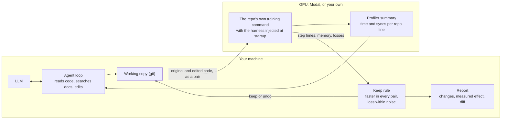

# AgenticTorch

AgenticTorch is an AI agent that finds slow PyTorch training code and fixes it. It
profiles a repo's real training run, tries one change at a time, and keeps a change
only when a rerun on the GPU shows it is faster and the loss hasn't moved.

On 15 popular open-source repos, the agent with gpt-6.1-sol made 14 faster: up to
5.52x, and 2.36x on average (geometric mean). The same model editing the code once,
with no testing and no second try, averaged 1.92x and shipped 3 harmful changes; the
agent shipped none. All runs used an NVIDIA L4.

## Results

Every training run used a [Modal](https://modal.com) container with an NVIDIA L4
(24 GB), 8 CPU cores and 16 GB of memory, running Python 3.12 and PyTorch 2.14.1. Each
repo is fixed at one commit, listed in its `targets/<name>/target.toml`, so every run
uses the same code. The agent itself ran on macOS with OpenAI's gpt-6.1-sol and the
smaller gpt-6-luna. Every number comes from a run saved in `results/`, and
`uv run python -m agentictorch.scoreboard` rebuilds the tables.

Each measurement runs the original and the changed code in the same container, once
per seed for two seeds, for 50 steps after 10 warm-up steps. A change is kept only if
it is at least 3% faster in every pair and its final loss is within run-to-run noise.
Speedup is the original step time divided by the new one.

### The agent on 15 repos

With gpt-6.1-sol:

| Repo | Stars | Step time (ms) | Speedup | Changes that made it faster |
|---|---|---|---|---|
| [lucidrains/x-transformers](https://github.com/lucidrains/x-transformers) | 5,961 | 700.9 → 127.1 | 5.52x | flash attention, bf16, torch.compile, fused Adam |
| [yanx27/Pointnet_Pointnet2_pytorch](https://github.com/yanx27/Pointnet_Pointnet2_pytorch) | 4,967 | 279.8 → 57.2 | 4.89x | no syncs in point sampling, a Triton sampling kernel, bf16 convolutions |
| [Blealtan/efficient-kan](https://github.com/Blealtan/efficient-kan) | 4,660 | 19.1 → 5.3 | 3.58x | DataLoader workers, torch.compile with CUDA graphs, pinned copies |
| [lucidrains/rectified-flow-pytorch](https://github.com/lucidrains/rectified-flow-pytorch) | 489 | 433.9 → 138.5 | 3.13x | DataLoader workers, torch.compile, bf16, fused Adam |
| [monologg/JointBERT](https://github.com/monologg/JointBERT) | 749 | 139.4 → 51.4 | 2.72x | bf16 autocast, fused AdamW, torch.compile |
| [w86763777/pytorch-ddpm](https://github.com/w86763777/pytorch-ddpm) | 646 | 555.3 → 218.7 | 2.54x | bf16 autocast, torch.compile, channels_last |
| [lucidrains/vit-pytorch](https://github.com/lucidrains/vit-pytorch) | 25,553 | 27.6 → 11.3 | 2.43x | DataLoader workers, fused attention, torch.compile with CUDA graphs |
| [yenchenlin/nerf-pytorch](https://github.com/yenchenlin/nerf-pytorch) | 6,058 | 179.1 → 73.7 | 2.43x | bf16 for the MLP, torch.compile |
| [Spijkervet/SimCLR](https://github.com/Spijkervet/SimCLR) | 825 | 426.1 → 178.3 | 2.39x | bf16 autocast, channels_last, pinned copies |
| [eriklindernoren/PyTorch-GAN](https://github.com/eriklindernoren/PyTorch-GAN) | 17,457 | 29.2 → 13.6 | 2.15x | DataLoader workers, pinned copies, fused Adam |
| [eriklindernoren/PyTorch-YOLOv3](https://github.com/eriklindernoren/PyTorch-YOLOv3) | 7,436 | 494.3 → 235.1 | 2.10x | bf16 autocast, channels_last, persistent DataLoader workers |
| [lucidrains/transfusion-pytorch](https://github.com/lucidrains/transfusion-pytorch) | 1,408 | 81.6 → 51.3 | 1.58x | torch.compile |
| [Zeleni9/pytorch-wgan](https://github.com/Zeleni9/pytorch-wgan) | 809 | 76.6 → 54.5 | 1.41x | DataLoader workers, no generator gradients in critic steps, cuDNN autotuning, fused Adam |
| [giddyyupp/ganilla](https://github.com/giddyyupp/ganilla) | 482 | 133.4 → 99.5 | 1.34x | torch.compile, pinned copies |
| [facebookresearch/detr](https://github.com/facebookresearch/detr) | 15,352 | 207.9 | nothing kept |  |

Every kept change passed the loss check. On DETR nothing the agent tried was faster:
at batch size 2, Python overhead per op sets the pace. The pytorch-ddpm and
rectified-flow-pytorch runs stopped before their final measurement, so those rows come
from measuring the kept changes again (`results/final-pairs/`). No pull requests have
been sent yet.

### Agent vs one patch

The `llm` setup gives the same model the same start as the agent (the training
command, tools to read and edit code, and hints from a static scan) but no way to run
anything. It writes one patch, which ships whatever it does: a crash, a moved loss or
a slowdown counts as harmful, and a crash counts as 1.00x. Geometric means over the 15
repos:

| Model | Agent | One patch | Agent vs one patch | Harmful changes (agent, one patch) |
|---|---|---|---|---|
| gpt-6.1-sol | 2.36x | 1.92x | 1.23x | 0, 3 |
| gpt-6-luna | 1.48x | 1.31x | 1.13x | 0, 6 |

Testing each change mostly removed the harm. The single patches shipped crashes, a
moved loss and slowdowns, such as 0.60x on PyTorch-YOLOv3 from cuDNN autotuning and
torch.compile on batch shapes that keep changing. The agent tried some of the same
changes, and its quick check or keep rule caught them. With gpt-6.1-sol the single
patch still beat the agent on 5 repos, mostly by bundling small changes that the agent
tested one at a time and dropped as within noise.

## How it works



1. **Baseline.** Run the repo's own training command for a few dozen steps per seed.
2. **Profile.** A short run under the PyTorch profiler, summarized as text: GPU busy
   share, data-loading wait, host-device syncs and the top ops, each tied to the repo
   line behind it.
3. **Diagnose.** The model reads the summary and the code, and can search a local
   index of PyTorch and NVIDIA performance docs.
4. **Try a fix.** It edits a git copy of the repo. A five-step quick check catches
   crashes before a full benchmark.
5. **Keep or revert.** The edit runs as a pair against the best version so far, and
   plain code, not the model, decides what stays.
6. **Report.** After up to five rounds, a final pair measures the original against
   everything kept. The report lists each attempt, its measured effect and the diff.

Some details:
- The repo's code isn't changed for measuring. A `sitecustomize.py` on `PYTHONPATH`
  loads first. It times steps with a global optimizer step hook, keeps the loss
  tensors to read at the end instead of syncing every step, seeds the run and stops it
  cleanly after N steps.
- Runs are paired because containers differ: the same PyTorch-GAN code ran at 19.1 ms
  per step in one container and 28.9 ms in another (`results/unpaired/`).
- In the profile run, a `TorchFunctionMode` tags each torch call from repo code with
  its source line, and CUDA's sync debug mode does the same for host-device syncs.
- The docs search combines BM25 with local `bge-small-en-v1.5` embeddings and reranks
  with `bge-reranker-base`.

## Build and run

You need Python 3.12, [uv](https://docs.astral.sh/uv/), a GPU (a Modal account or
your own NVIDIA GPU) and a model: an OpenAI or Gemini API key, or a local model
through [Ollama](https://ollama.com).

Build, from a clone of this repo:

```
uv sync                                         # install dependencies
uv run pytest                                   # unit tests, CPU only
uv run modal setup                              # log in to Modal; opens a browser
export OPENAI_API_KEY=...                       # or GEMINI_API_KEY, or ~/agentictorch-work/.env
uv run python -m agentictorch.kb.fetch          # download the performance docs
uv run python -m agentictorch.kb.search build   # build the search index
```

Run the agent on one of the 15 repos in `targets/`:

```
uv run agentictorch download pytorch-ddpm       # fetch its dataset, once
uv run agentictorch measure pytorch-ddpm        # optional: time the original code
uv run agentictorch run pytorch-ddpm --model gpt-6.1-sol
```

The report lands in `results/eval/agent/pytorch-ddpm/`, and the edited code in
`~/agentictorch-work/work/pytorch-ddpm/`, a git copy with one commit per kept change.
To use the changes, check out the repo at the commit in its `target.toml`, `git apply`
the report's diff, and run a full training job before trusting precision changes.

To run it on your own repo, add `targets/<name>/target.toml`:

```toml
repo = "https://github.com/you/your-repo"      # or a local git folder
commit = "a1b2c3d"                              # fixed, so every run uses the same code
command = "python train.py --config base.yaml"  # your usual training command

[image]
pip = ["timm", "einops"]                        # packages beyond PyTorch

[data]                                          # optional
dataset = "my-data"                             # folder name in Modal storage
path = "data"                                   # where your code expects it
download = "python scripts/download.py"         # how to fetch it, once
```

Then `download`, `measure` and `run` it by name. The repo needs a training run that
starts with one command on one GPU and steps a `torch.optim` optimizer.

To use your own NVIDIA GPU instead of Modal, add `--backend local` to
`download`, `measure` and `run`. The repo's code then runs directly on your machine,
so use it only for code you trust.

## Limitations

- Runs are short, so the loss check covers only a few dozen steps. A change that
  hurts convergence later would pass.
- Speedups depend on the GPU, and every result here is from an L4.
- Testing one change at a time against a 3% bar drops small gains that only pay off
  together.
- Python only. A compiled C++/CUDA extension shows up only as GPU kernels, and the
  agent doesn't edit it.
- The local GPU backend has only been tested in CPU mode, on our own test scripts.

## What didn't work

- The profiler's own stack traces (`with_stack=True`) named frames by their function's
  `def` line on PyTorch 2.14, not the line that ran. The source-line tags replaced
  them.
- Trusting the data-wait share. On x-transformers, 61% of each step showed as waiting
  on the DataLoader, yet batching the copies cut that to 0% without changing the step
  time. The GPU busy share (88%) was the real signal.
- float16 without a GradScaler. The agent kept it on two repos; the loss matched over
  the short run, but small gradients can underflow over a long one. It now refuses
  float16 unless the repo uses a GradScaler.

## Credits

PyTorch's and NVIDIA's performance documentation, which the docs search indexes.
BAAI's bge models through sentence-transformers. The authors of the 15 target repos.

MIT license.
