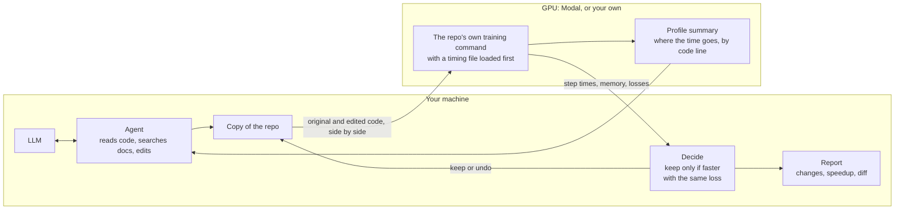

# AgenticTorch

AgenticTorch is an AI agent that finds slow PyTorch training code and fixes it. It
profiles a repo's real training run, tries one change at a time, and keeps a change
only when a rerun on the GPU shows it is faster and the loss hasn't moved.

On 15 popular open-source repos, the agent with gpt-6.1-sol made 14 faster: up to
5.52x, and 2.36x on average (geometric mean). The same model editing the code once,
with no testing and no second try, averaged 1.92x and made 3 harmful changes; the
agent made none. All runs used an NVIDIA L4.

## Results

Every training run used a [Modal](https://modal.com) container with an NVIDIA L4
(24 GB), 8 CPU cores and 16 GB of memory, running Python 3.12 and PyTorch 2.14.1. Each
repo is fixed at one commit, listed in its `targets/<name>/target.toml`, so every run
uses the same code. The agent itself ran on macOS with OpenAI's gpt-6.1-sol and the
smaller gpt-6-luna. Every number comes from a run saved in `results/`, and
`uv run python -m agentictorch.scoreboard` rebuilds the tables.

Each number compares the original and the changed code side by side in the same
container, with two seeds, over 50 steps after 10 warm-up steps. Speedup is the
original step time divided by the new one. A change is kept only if it is at least 3%
faster with both seeds and the loss stays within run-to-run noise.

### The agent on 15 repos (gpt-6.1-sol)

| Repo | Stars | Step time (ms) | Speedup | Changes that made it faster |
|---|---|---|---|---|
| [lucidrains/x-transformers](https://github.com/lucidrains/x-transformers) | 5,961 | 700.9 → 127.1 | 5.52x | flash attention, bf16, torch.compile, fused Adam |
| [yanx27/Pointnet_Pointnet2_pytorch](https://github.com/yanx27/Pointnet_Pointnet2_pytorch) | 4,967 | 279.8 → 57.2 | 4.89x | no syncs in point sampling, a Triton sampling kernel, bf16 convolutions |
| [Blealtan/efficient-kan](https://github.com/Blealtan/efficient-kan) | 4,660 | 19.1 → 5.3 | 3.58x | DataLoader workers, torch.compile with CUDA graphs, pinned copies |
| [lucidrains/rectified-flow-pytorch](https://github.com/lucidrains/rectified-flow-pytorch) | 489 | 433.9 → 138.5 | 3.13x | DataLoader workers, torch.compile, bf16, fused Adam |
| [monologg/JointBERT](https://github.com/monologg/JointBERT) | 749 | 139.4 → 51.4 | 2.72x | bf16 autocast, fused AdamW, torch.compile |
| [w86763777/pytorch-ddpm](https://github.com/w86763777/pytorch-ddpm) | 646 | 555.3 → 218.7 | 2.54x | bf16 autocast, torch.compile, channels_last |
| [lucidrains/vit-pytorch](https://github.com/lucidrains/vit-pytorch) | 25,553 | 27.6 → 11.3 | 2.43x | DataLoader workers, fused attention, torch.compile with CUDA graphs |
| [yenchenlin/nerf-pytorch](https://github.com/yenchenlin/nerf-pytorch) | 6,058 | 179.1 → 73.7 | 2.43x | bf16 for the MLP, torch.compile |
| [Spijkervet/SimCLR](https://github.com/Spijkervet/SimCLR) | 825 | 426.1 → 178.3 | 2.39x | bf16 autocast, channels_last, pinned copies |
| [eriklindernoren/PyTorch-GAN](https://github.com/eriklindernoren/PyTorch-GAN) | 17,457 | 29.2 → 13.6 | 2.15x | DataLoader workers, pinned copies, fused Adam |
| [eriklindernoren/PyTorch-YOLOv3](https://github.com/eriklindernoren/PyTorch-YOLOv3) | 7,436 | 494.3 → 235.1 | 2.10x | bf16 autocast, channels_last, persistent DataLoader workers |
| [lucidrains/transfusion-pytorch](https://github.com/lucidrains/transfusion-pytorch) | 1,408 | 81.6 → 51.3 | 1.58x | torch.compile |
| [Zeleni9/pytorch-wgan](https://github.com/Zeleni9/pytorch-wgan) | 809 | 76.6 → 54.5 | 1.41x | DataLoader workers, no generator gradients in critic steps, cuDNN autotuning, fused Adam |
| [giddyyupp/ganilla](https://github.com/giddyyupp/ganilla) | 482 | 133.4 → 99.5 | 1.34x | torch.compile, pinned copies |
| [facebookresearch/detr](https://github.com/facebookresearch/detr) | 15,352 | 207.9 | 1.00x | none |

### Agent vs single patch

The single patch (`--setup llm`) starts from the same place as the agent: the training
command, tools to read and edit code, and hints from a static scan. The model edits
the code once and the patch is used as is. A crash, a changed loss or a slowdown
counts as harmful, and a crash counts as 1.00x. Averages are geometric means over the
15 repos:

| Model | Agent | Single patch | Agent vs single patch | Harmful changes |
|---|---|---|---|---|
| gpt-6.1-sol | 2.36x | 1.92x | 1.23x | 0 vs 3 |
| gpt-6-luna | 1.48x | 1.31x | 1.13x | 0 vs 6 |

Because the agent tests every change, it never made a repo worse. The single patches
did: some crashed or timed out, one changed the loss, and five made training slower,
the worst at 0.60x on PyTorch-YOLOv3. The agent tried some of the same changes, but
its tests caught the problems and it undid them. With gpt-6.1-sol, the single patch
was still faster on 5 repos. On most of them it made several small changes together;
the agent tried them one at a time and undid each one, since alone it was too small
to count.

## How it works



1. **Measure the original.** Run the repo's own training command for a few dozen
   steps, once for each of two seeds, and record the time per step, memory and loss.
2. **Find where the time goes.** Run a short training under the PyTorch profiler and
   turn the result into a short text summary: how busy the GPU is, how long it waits
   for data, how often the CPU waits for the GPU, and which operations take the most
   time, each with the line of code that caused it.
3. **Pick a fix.** The model reads the summary and the code. It can also search a
   local copy of PyTorch and NVIDIA performance guides.
4. **Try it.** The model edits a copy of the repo. A 5-step test run catches crashes
   before the full timing run.
5. **Keep it or undo it.** The edited code and the best version so far run side by
   side. The change stays only if it is faster and the loss is the same. Plain code
   makes this call, not the model.
6. **Report.** After up to 5 tries, the original and the final code run side by side
   one last time. The report lists every change tried, how much each one helped, and
   the final diff.

Some details:
- **Timing without changing the repo.** A small Python file (`sitecustomize.py`) loads
  before the repo's code. It times each training step, records the loss without
  slowing the run, fixes the random seeds, and stops the run cleanly after a set
  number of steps.
- **Finding the slow line.** During the profile run, every PyTorch call from the
  repo's code is tagged with its file and line, and so is every place where the CPU
  waits for the GPU. That's how the summary can point at the exact line to fix.
- **Docs search.** Keyword search, plus two small search models that download
  automatically: one matches by meaning, the other sorts the results. It all runs on
  your machine.

## Build and run

You need Python 3.12, [uv](https://docs.astral.sh/uv/), a GPU (a Modal account or
your own NVIDIA GPU) and a model: an OpenAI or Gemini API key, or a local model
through [Ollama](https://ollama.com).

Build, from a clone of this repo:

```
uv sync                                         # install dependencies
uv run pytest                                   # unit tests, CPU only
uv run modal setup                              # log in to Modal; opens a browser
export OPENAI_API_KEY=...                       # or GEMINI_API_KEY (or save it in ~/agentictorch-work/.env)
uv run python -m agentictorch.kb.fetch          # download the performance docs
uv run python -m agentictorch.kb.search build   # build the search index
```

Run the agent on one of the 15 repos in `targets/`:

```
uv run agentictorch download pytorch-ddpm       # fetch its dataset, once
uv run agentictorch measure pytorch-ddpm        # optional: time the original code
uv run agentictorch run pytorch-ddpm --model gpt-6.1-sol
```

**What you get.** When the run ends:
- A report in `results/eval/agent/pytorch-ddpm/`: a `.md` file to read and a `.json`
  file with the raw numbers. It lists every change the agent tried, how much faster
  each one was, and the final code diff.
- The edited code in `~/agentictorch-work/work/pytorch-ddpm/`, in a folder named after
  the run. It's a git copy of the repo with one commit per change that made it faster.

**Using the changes.**
1. Check out the repo at the commit listed in its `targets/<name>/target.toml`.
2. Copy the diff from the report's "Diff of the kept changes" section into a file,
   for example `fix.diff`, and run `git apply fix.diff`.
3. If the changes include bf16 or float16, run a full training job before you rely on
   them. The agent only checks the loss over a few dozen steps.

**Your own repo.** It needs a training script that starts with one command, runs on
one GPU, and uses a PyTorch optimizer from `torch.optim`. Create
`targets/<name>/target.toml`, where `<name>` is a short name you pick:

```toml
repo = "https://github.com/you/your-repo"      # GitHub URL or a local git folder
commit = "a1b2c3d"                              # the commit to test
command = "python train.py --config base.yaml"  # how you normally start training

[image]
pip = ["timm", "einops"]                        # packages your code needs besides PyTorch

[data]                                          # only if your code needs a dataset
dataset = "my-data"                             # a name for the dataset
path = "data"                                   # the folder your code reads it from
download = "python scripts/download.py"         # the command that downloads it
```

Then run the same commands with your name:

```
uv run agentictorch download <name>             # only if you added [data]
uv run agentictorch measure <name>              # checks that your training can be timed
uv run agentictorch run <name> --model gpt-6.1-sol
```

**Your own GPU.** To use your own NVIDIA GPU instead of Modal, add `--backend local`
to each command, for example `uv run agentictorch run <name> --backend local`. Your
repo's code then runs directly on your computer instead of in an isolated container,
so only do this with code you trust.

## Limitations

- **Short runs.** Each run is a few dozen steps, so the loss check only covers those
  steps. A change that hurts training later on would still pass.
- **One GPU type.** How much a change helps depends on the GPU. Every result here is
  from an L4.
- **One change at a time.** A change stays only if it alone is at least 3% faster, so
  small changes that only help when combined get undone.
- **Python only.** The agent edits Python code. It doesn't look inside or edit
  compiled C++ or CUDA code.
- **Own-GPU mode is barely tested.** `--backend local` has only been tried without a
  GPU, on our own small test scripts.

## What didn't work

- **PyTorch's built-in code lines.** The profiler's own option for this
  (`with_stack=True`) pointed at the line where each function starts, not the line
  that ran (PyTorch 2.14). So we tag each call with its line ourselves.
- **Trusting the "waiting for data" number.** On x-transformers the profiler said 61%
  of each step was spent waiting for data. Fixing the data loading cut the wait to 0%,
  but each step took just as long. The number that mattered was that the GPU was
  already busy 88% of the time.
- **float16 without a GradScaler.** The agent kept float16 on two repos because the
  loss looked fine over the short run. Without a GradScaler, small gradients can round
  down to zero over a long run. Now the agent only uses float16 if the repo already
  has a GradScaler.

## Credits

PyTorch's and NVIDIA's performance documentation, which the docs search indexes.
BAAI's bge models through sentence-transformers. The authors of the 15 target repos.

MIT license.
