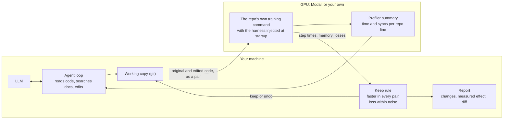

# AgenticTorch

AgenticTorch is an AI agent that finds slow PyTorch training code and fixes it. It
profiles a repo's real training run, tries one change at a time, and keeps a change
only when a rerun on a GPU shows it is faster and the loss hasn't moved.

On 15 popular open-source repos it made training up to 3.90x faster, with 10 of the 15
sped up on an A100. Given the same model, the loop beat letting that model patch the
code blind: 2.36x against 1.92x on average with gpt-6.1-sol and 1.48x against 1.31x
with the smaller gpt-6-luna, and the blind patches shipped 3 and 6 harmful changes
where the agent shipped none.

## Results

Every number below comes from a run saved in `results/`, and
`python -m agentictorch.scoreboard` rebuilds the tables. A few terms used throughout:

- **Speedup** is the original step time divided by the new one. 2.00x means each
  training step takes half as long; 1.00x means no change.
- **Paired runs:** the original and the changed code run in the same container on the
  same GPU, once per seed (two seeds), in alternating order, for 50 measured steps
  after 10 warm-up steps. The speedup is the geometric mean of the per-pair ratios.
- **Loss within noise:** the changed code's final loss passes a two-sample t-test
  against the run-to-run spread, so the change didn't alter what the model learns
  over the measured steps.
- **Kept:** the agent keeps a change only if it is at least 3% faster in every pair and
  the loss is within noise. Anything else, including a crash, is undone.
- **Harmful:** a change that crashed, slowed training or moved the loss. A blind patch
  ships whatever it does; in averages a crash counts as 1.00x.
- **Geometric mean** is the average used for speedups. They are ratios, and it keeps one
  big win from hiding the rest.
- **L4 and A100** are the GPUs. Speedups are only compared on the same GPU type.

### Where it was tested

Every measurement ran on Modal. Development and all the comparisons used an NVIDIA L4
(24 GB); the headline table used A100-40GB requests, which Modal sometimes served with
an 80 GB or PCIe card, and both sides of a pair always shared one card. Each container
had 8 CPU cores and 16 GB of memory and ran Debian with Python 3.12, PyTorch 2.14.1 and
torchvision 0.29.1, plus each repo's own packages at a pinned commit. The agent, the
code edits and the keep rule ran on macOS with Python 3.12, calling OpenAI's
gpt-6-luna and gpt-6.1-sol; the planted test suite also used a 9B model through
Ollama. All runs date from October 2026.

After the final cleanup of the code, two runs were repeated as a check, saved in
`results/reruns/`. The gpt-6.1-sol agent on PointNet++ kept the same three changes and
measured 4.94x (4.89x in the tables below), and the gpt-6-luna agent on PyTorch-GAN
measured 2.04x (2.03x).

### The agent on 15 real repos

The agent ran with gpt-6-luna, a small OpenAI model. For each repo where it kept a
change, the original and the changed code were measured again on an A100:

| Repo | Stars | GPU | Before (ms/step) | After (ms/step) | Speedup | Loss | Fixes | Pull request |
|---|---|---|---|---|---|---|---|---|
| [monologg/JointBERT](https://github.com/monologg/JointBERT) | 749 | A100-SXM4-40GB | 67.4 | 17.3 | 3.90x | within noise | bf16 autocast, fused AdamW, torch.compile with CUDA graphs | not sent |
| [Blealtan/efficient-kan](https://github.com/Blealtan/efficient-kan) | 4,660 | A100-SXM4-40GB | 13.7 | 4.0 | 3.42x | within noise | DataLoader workers with pinned memory, torch.compile | not sent |
| [yanx27/Pointnet_Pointnet2_pytorch](https://github.com/yanx27/Pointnet_Pointnet2_pytorch) | 4,967 | A100-SXM4-40GB | 235.4 | 108.3 | 2.17x | within noise | no sync per point in farthest point sampling | not sent |
| [yenchenlin/nerf-pytorch](https://github.com/yenchenlin/nerf-pytorch) | 6,058 | A100-SXM4-80GB | 80.8 | 39.4 | 2.05x | within noise | TF32 matmuls | not sent |
| [eriklindernoren/PyTorch-GAN](https://github.com/eriklindernoren/PyTorch-GAN) | 17,457 | A100-SXM4-40GB | 24.5 | 12.0 | 2.04x | within noise | DataLoader workers with pinned memory | not sent |
| [eriklindernoren/PyTorch-YOLOv3](https://github.com/eriklindernoren/PyTorch-YOLOv3) | 7,436 | A100-SXM4-40GB | 265.4 | 146.4 | 1.81x | within noise | bf16 autocast, persistent DataLoader workers, fused Adam | not sent |
| [Zeleni9/pytorch-wgan](https://github.com/Zeleni9/pytorch-wgan) | 809 | A100-SXM4-40GB | 39.5 | 28.7 | 1.38x | within noise | DataLoader workers with pinned memory | not sent |
| [lucidrains/vit-pytorch](https://github.com/lucidrains/vit-pytorch) | 25,553 | A100-SXM4-80GB | 19.8 | 15.8 | 1.22x | within noise | DataLoader workers with pinned memory, fused Adam | drafted, not sent |
| [w86763777/pytorch-ddpm](https://github.com/w86763777/pytorch-ddpm) | 646 | A100-SXM4-40GB | 144.7 | 118.3 | 1.22x | within noise | bf16 autocast for the forward pass and loss | not sent |
| [lucidrains/rectified-flow-pytorch](https://github.com/lucidrains/rectified-flow-pytorch) | 489 | A100 80GB PCIe | 245.9 | 202.3 | 1.22x | within noise | DataLoader workers with pinned memory | issue drafted, not sent |
| [Spijkervet/SimCLR](https://github.com/Spijkervet/SimCLR) | 825 | A100-SXM4-40GB | 178.1 | 175.8 | 1.01x (1.01x is within noise) | within noise | bf16 autocast, channels_last | not sent |
| [facebookresearch/detr](https://github.com/facebookresearch/detr) | 15,352 | L4 | 205.0 |  | nothing kept |  |  | not sent |
| [giddyyupp/ganilla](https://github.com/giddyyupp/ganilla) | 482 | L4 | 130.5 |  | nothing kept |  |  | not sent |
| [lucidrains/transfusion-pytorch](https://github.com/lucidrains/transfusion-pytorch) | 1,408 | L4 | 85.3 |  | nothing kept |  |  | not sent |
| [lucidrains/x-transformers](https://github.com/lucidrains/x-transformers) | 5,961 | L4 | 717.8 |  | nothing kept |  |  | drafted from the gpt-6.1-sol run, not sent |

"Nothing kept" means every change the agent tried crashed, was slower or was within
noise, so the original code stands. The GPU column is the card Modal assigned to an
A100-40GB request, billed as an A100-40GB; both sides of a pair always ran on the same
card. SimCLR shows how much the GPU matters: its changes were 2.06x faster on an L4,
but on the A100 the GPU work shrank until image augmentation on 8 CPU cores set the
pace (data wait rose from 4% to 36% of each step). PyTorch-YOLOv3 shows the same
effect more mildly, 2.07x on an L4 and 1.81x on the A100.

No pull requests have been sent yet. 11 of the 15 repos haven't merged a pull request
from outside their team in the last 12 months.

### Same model, with and without the loop

Each repo fixed five ways, each measured against the original code on an L4; 1.00x
means nothing was kept:
- **Agent, gpt-6.1-sol:** the full loop with the stronger model.
- **One patch, gpt-6.1-sol:** the same model without the loop (the `llm` setup). It
  reads the code and writes one patch without running anything, and the patch ships
  whatever it does.
- **Agent, gpt-6-luna** and **One patch, gpt-6-luna:** the same pair with the small
  model.
- **Reference model, direct:** the fixes from the section above. A different model
  working directly, with measurements, so a reference rather than a test of the loop.

The agent and the one patch start from the same information: the training command,
the same tools for reading and editing code, and the same hints from a static scan of
the code (likely problems such as a DataLoader on the main thread or a sync in the
loop, with file and line). What the one patch lacks is everything that comes from
running the code (the profile, the quick check and the paired benchmarks) and the
docs search, which made no difference to blind patches in a smaller test below
(1.54x without it, 1.48x with it). So the comparison is mostly about what measuring
adds. The hints point the one patch at real problems, which if anything makes it the
stronger baseline.

| Repo | Agent, gpt-6.1-sol | One patch, gpt-6.1-sol | Agent, gpt-6-luna | One patch, gpt-6-luna | Reference model, direct |
|---|---|---|---|---|---|
| detr | 1.00x | 1.00x harmful | 1.00x | 0.97x | 1.06x |
| efficient-kan | 3.58x | 2.17x | 3.40x | 3.39x | 4.30x |
| ganilla | 1.34x | 1.54x | 1.00x | 0.95x harmful | 1.13x |
| jointbert | 2.72x | 3.05x | 2.65x | 1.66x | 2.20x |
| nerf-pytorch | 2.43x | 2.71x | 1.18x | 2.49x | 1.30x |
| pointnet2 | 4.89x | 1.93x | 1.65x | 1.00x harmful | 2.61x |
| pytorch-ddpm | 2.54x | 2.52x | 1.29x | 1.37x | 2.28x |
| pytorch-gan-dcgan | 2.15x | 1.93x | 2.03x | 2.05x | 2.10x |
| pytorch-wgan | 1.41x | 1.59x | 1.18x | 1.00x harmful | 2.17x |
| pytorch-yolov3 | 2.10x | 0.60x harmful | 2.07x | 0.78x harmful | 2.28x |
| rectified-flow-pytorch | 3.13x | 3.17x | 1.17x | 1.13x | 3.12x |
| simclr | 2.39x | 2.50x | 2.06x | 1.62x | 2.44x |
| transfusion-pytorch | 1.58x | 0.86x harmful | 1.00x | 0.88x harmful | 1.55x |
| vit-pytorch | 2.43x | 1.80x | 1.37x | 1.26x | 1.74x |
| x-transformers | 5.52x | 5.61x | 1.00x | 1.00x harmful | 4.13x |
| **Geometric mean** | **2.36x** | **1.92x** | **1.48x** | **1.31x** | **2.12x** |
| Harmful changes shipped | 0 | 3 | 0 | 6 | 0 |

Side by side for each model:

| Model | Agent | One patch | Agent vs one patch | Harmful changes (agent, one patch) |
|---|---|---|---|---|
| gpt-6.1-sol | 2.36x | 1.92x | 1.23x | 0, 3 |
| gpt-6-luna | 1.48x | 1.31x | 1.13x | 0, 6 |

On a typical repo the agent was 1.23x faster than the same model's blind patch with
gpt-6.1-sol and 1.13x faster with gpt-6-luna, and it shipped no harmful change where
the blind patches shipped 3 and 6.

The loop beat the same model patching blind, with both models. With gpt-6.1-sol
the agent's geometric mean was 2.36x against 1.92x for one blind patch, and it
shipped no harm where the blind patch shipped three: PyTorch-YOLOv3 at 0.60x (cuDNN
autotuning and torch.compile, on batch shapes that keep changing),
transfusion-pytorch at 0.86x (bf16 on a transformer too small to gain from it), and
DETR, whose compiled patch timed out. The agent was ahead on 6 repos, level on 4 and
behind on 5.

The small model needed the loop more. With gpt-6-luna the agent reached 1.48x
against 1.31x, ahead on 10 repos, level on 3 and behind on 2: nerf-pytorch, where the
blind patch compiled the networks and ran the render in bf16, and pytorch-ddpm, where
it added bf16 with fused Adam, pinned copies and cuDNN autotuning. Its blind patches
shipped six harmful changes: two crashes (torch.compile on pytorch-wgan, which can't
take the gradient penalty's second backward pass, and DataLoader workers on
x-transformers, whose dataset builds CUDA tensors), a loss change on PointNet++, and
slowdowns on PyTorch-YOLOv3 (0.78x), transfusion-pytorch (0.88x) and ganilla
(0.95x). The agent tried some of the same changes; its quick check or keep rule
caught them.

Measuring one change at a time does leave gains behind. The blind patch bundles
every change the model is confident about. The agent keeps a change only if it is
at least 3% faster in every pair on its own, so gains that are small alone, or that
only pay off together, get dropped. On JointBERT the agent tried ignore-index labels
in place of the masked slot gathers before compiling, measured 0.95x and reverted
them; the blind patch made that change together with compiling, where it also
removes a graph break, and measured 3.05x against the agent's 2.72x. On nerf-pytorch
the agent measured fused Adam and removing the debug-check syncs alone as within
noise (1.00x to 1.04x) and reverted them; the blind patch kept them with the rest:
2.71x against 2.43x.

The model sets the ceiling. gpt-6.1-sol was faster than gpt-6-luna on 14 of the
15 repos, by more than 10% on 10 of them, and tied on DETR. Most of the gap is
torch.compile: gpt-6.1-sol got it working on 9 repos, gpt-6-luna on 2, and gpt-6-luna
never tried it on five others. gpt-6.1-sol also kept bf16 on 8 repos to gpt-6-luna's
4, used 62 of 65 benchmark rounds in its runs with reports where gpt-6-luna often
stopped early (53 of 75), and made three changes gpt-6-luna never tried: switching
on x-transformers' existing flash attention option, replacing vit-pytorch's
hand-written attention with PyTorch's fused `scaled_dot_product_attention`, and a
Triton kernel for PointNet++.

The reference model reached 2.12x working directly. The agent with
gpt-6.1-sol was ahead of it on 7 repos, level on 4 and behind on 4; the agent with
gpt-6-luna was behind (1.48x). Three of the direct fixes were made after the agent
runs (below).

#### What the agent and the one patch each changed (both gpt-6.1-sol)

A number in brackets is that change's own measured gain in its round.

Where the agent was faster:

| Repo | Agent | One patch | What decided it |
|---|---|---|---|
| pointnet2 | 4.89x | 1.93x | Both removed the syncs in farthest point sampling; only the agent went on to a Triton kernel for the whole sampling loop (1.95x), checked over measured rounds |
| pytorch-yolov3 | 2.10x | 0.60x harmful | The patch turned on cuDNN autotuning and torch.compile on batch shapes that keep changing, and missed persistent DataLoader workers, the agent's biggest win (1.50x) |
| efficient-kan | 3.58x | 2.17x | The agent kept four persistent workers (2.46x) and compiling with CUDA graphs (1.28x); the patch used two workers, plain compile and bf16, and which part slowed it is untested |
| vit-pytorch | 2.43x | 1.80x | Both switched to fused attention; only the agent compiled, with CUDA graphs (1.51x) |
| transfusion-pytorch | 1.58x | 0.86x harmful | The patch added bf16, which slows this small transformer (the agent measured 0.97x and reverted it), and didn't compile; the agent's compile gave 1.56x |
| pytorch-gan-dcgan | 2.15x | 1.93x | The same DataLoader fix; the patch added bf16 and cuDNN autotuning to a tiny GAN, and which part slowed it is untested |

Where the one patch was faster:

| Repo | One patch | Agent | What decided it |
|---|---|---|---|
| jointbert | 3.05x | 2.72x | The same bf16, fused AdamW and compile, plus ignore-index labels and pinned copies, which the agent measured alone (0.95x, 1.02x) and reverted |
| nerf-pytorch | 2.71x | 2.43x | The same bf16 for the MLP and compile, plus small changes the agent measured alone as within noise and reverted (fused Adam, the debug-check syncs) |
| pytorch-wgan | 1.59x | 1.41x | bf16 for both networks, with the gradient penalty in float32, which the agent never tried |
| ganilla | 1.54x | 1.34x | bf16 and fused Adam on top of compile; the agent measured bf16 alone, before compiling, at 0.92x and reverted it |
| simclr | 2.50x | 2.39x | The same bf16 and pinned copies, plus compile and fewer syncs; the agent measured compile alone at 1.02x and reverted it |

Level (within 3%): x-transformers (5.52x against 5.61x) and rectified-flow-pytorch
(3.13x against 3.17x), with the same main changes; pytorch-ddpm (2.54x against
2.52x), where the agent's channels_last and the patch's fused attention came out
even; and DETR, where neither gained and the patch timed out.

PointNet++ was the hardest. Its farthest point sampling is a Python loop of 640
steps per forward pass, and a masked update inside it (`distance[mask] = dist[mask]`)
made the CPU wait for the GPU 1,280 times per step; the GPU was busy 11% of the
time. Both models found that line in their first round, since the profiler names
it. Only gpt-6.1-sol got past the thousands of tiny kernel launches the loop still
made: it wrote a Triton kernel that runs the whole sampling loop at once, then added
bf16 for the convolutions. The kernel picks exactly the points the original loop
picks (identical in 40 of 40 test runs on a GPU, including inputs with many ties).
The reference model's direct fix replayed the loop from a CUDA graph instead and reached
2.61x; one blind patch from gpt-6.1-sol reached 1.93x.

DETR resisted everyone. At batch size 2, Python overhead per op sets the pace;
neither agent run kept a change, the blind patch's dynamic-shape compile timed out,
and the best of three direct attempts measured 1.06x.

On pytorch-ddpm and rectified-flow-pytorch, the gpt-6.1-sol agent run stopped before
its final measurement and wrote no report. Their numbers come from measuring the kept
changes against the original again, in pairs (`results/final-pairs/`).

For efficient-kan, PyTorch-GAN and pytorch-wgan, the direct fix was at first only the
one-line DataLoader fix from an early sanity check. The full direct fixes in the table
came after the agent runs, with their reports at hand; the pytorch-wgan one borrows
gpt-6.1-sol's idea of skipping the generator's gradients in critic steps.

### Against the reference model working directly

The same repos fixed by the reference model at max effort, editing each repo itself: it
read the code and the profiles and measured its attempts with the same paired
benchmark (up to three per repo, each bundling several changes), but outside the
agent loop. On an L4, as a reference for how much the agent with gpt-6-luna leaves on
the table:

| Repo | GPU | Original (ms/step) | Agent | Agent's changes | Reference model, direct | Its changes |
|---|---|---|---|---|---|---|
| efficient-kan | L4 | 17.3 | 3.40x | DataLoader workers with pinned memory, torch.compile | 4.30x | loader workers with pinned memory, no per-step syncs, CUDA graphs through torch.compile, fused AdamW |
| x-transformers | L4 | 707.7 | nothing kept |  | 4.13x | batches built on the CPU and copied once, flash attention, bf16 |
| rectified-flow-pytorch | L4 | 439.4 | 1.17x | DataLoader workers with pinned memory | 3.12x | bf16, torch.compile through accelerate, loader workers |
| pointnet2 | L4 | 274.0 | 1.65x | no sync per point in farthest point sampling | 2.61x | no syncs in farthest point sampling and grouping, sampling replayed from a CUDA graph, topk instead of a full sort, accuracy kept on the GPU |
| simclr | L4 | 416.6 | 2.06x | bf16 autocast, channels_last | 2.44x | bf16 autocast, channels_last, cudnn autotuning, pinned copies, no per-step epoch-loss sync |
| pytorch-ddpm | L4 | 549.2 | 1.29x | bf16 autocast for the forward pass and loss | 2.28x | bf16 autocast, compiled trainer, fused EMA update, one loss sync, pinned copies |
| pytorch-yolov3 | L4 | 529.2 | 2.07x | bf16 autocast, persistent DataLoader workers, fused Adam | 2.28x | bf16 forward with a float32 loss, channels_last convolutions, persistent workers, fewer syncs in the loss |
| jointbert | L4 | 137.9 | 2.65x | bf16 autocast, fused AdamW, torch.compile with CUDA graphs | 2.20x | bf16 autocast, fused AdamW, no per-step loss sync |
| pytorch-wgan | L4 | 77.9 | 1.18x | DataLoader workers with pinned memory | 2.17x | loader workers with pinned memory, noise sampled on the GPU, no generator gradients in critic steps, one sync per printed line, fused Adam, cudnn autotuning, bf16 networks with float32 outputs |
| pytorch-gan-dcgan | L4 | 28.6 | 2.03x | DataLoader workers with pinned memory | 2.10x | loader workers with pinned memory, noise sampled on the GPU, one sync for the printed losses, fused Adam, cudnn autotuning |
| vit-pytorch | L4 | 26.7 | 1.37x | DataLoader workers with pinned memory, fused Adam | 1.74x | loader workers, torch.compile, one sync for the printed losses |
| transfusion-pytorch | L4 | 92.5 | nothing kept |  | 1.55x | loader workers, compiled transformer forward |
| nerf-pytorch | L4 | 191.7 | 1.18x | TF32 matmuls | 1.30x | TF32, no per-step host copies or syncs, ray sampling on the GPU |
| ganilla | L4 | 123.2 | nothing kept |  | 1.13x | compiled networks, cudnn autotuning, pinned non-blocking input copies |
| detr | L4 | 195.4 | nothing kept |  | 1.06x | one sync for logging, box checks on the GPU, matcher indices copied once, pinned copies, 8 workers, bf16 forward |

With the standard fixes (mixed precision, DataLoader workers, fused optimizers),
the agent came within 10% of the direct fix or beat it on JointBERT, PyTorch-GAN,
PyTorch-YOLOv3 and nerf-pytorch. It fell far short where the win needed a bigger or
riskier change, such as flash attention behind a library flag (x-transformers),
compiling library code (rectified-flow, pytorch-ddpm, transfusion), or bf16 in a GAN
whose gradient penalty takes a second backward pass (pytorch-wgan).

### Against simpler setups

On the five GPU-bound repos, all with gpt-6-luna on an L4. `rules` applies a few AST
rules (DataLoader workers, explicit syncs in the loop), `llm` has the model read the
code and write one patch without running anything (with the same static hints as the
agent), `llm-kb` does the same with the documentation search, and `agent` is the full
loop. A blind patch ships
whatever it does, so a crash or a slowdown counts as harmful.

| Target | rules | llm | llm-kb | agent |
|---|---|---|---|---|
| ganilla | 1.00x | 0.95x harmful | 1.46x | 1.00x |
| jointbert | 1.00x | 1.66x | 1.70x | 2.65x |
| nerf-pytorch | 1.00x | 2.49x | 2.55x | 1.18x |
| pytorch-ddpm | 1.00x | 1.37x | 1.00x harmful | 1.29x |
| simclr | 1.00x | 1.62x | 1.11x | 2.06x |

| Setup | Targets | Speedup (geometric mean) | Harmful changes shipped | Harmful attempts caught |
|---|---|---|---|---|
| rules | 5 | 1.00x | 0 |  |
| llm | 5 | 1.54x | 1 |  |
| llm-kb | 5 | 1.48x | 1 |  |
| agent | 5 | 1.53x | 0 | 3 |

Measuring didn't raise the typical speedup here; it removed the harm. The blind
patches were bolder: on nerf-pytorch, compiling the model and running the whole
render in bf16 gave about 2.5x, where the agent kept only TF32. But blind patching
also shipped a slowdown on ganilla and a crash on pytorch-ddpm. The agent shipped
neither, and its keep rule caught three harmful attempts of its own.

### Planted test suite

Small scripts of our own (ResNet-18 on CIFAR-10, a character-level GPT, DistilBERT),
each with one planted mistake; the planted slowdown is how much faster the clean
script runs. 6 of the 14 mistakes made no measurable difference on an L4, in speed or
memory.
With a local 9B model (ornith-1.5 through Ollama), the agent won back all of a 2.48x
DataLoader slowdown (2.56x) and 92% of a 2.23x fp32 slowdown (2.03x). The local
model was too slow for the real repos: Ollama serves it one request at a time, so
three agents queued 4 to 12 minutes for each turn.

## Try it

You need Python 3.12, [uv](https://docs.astral.sh/uv/), a GPU (a
[Modal](https://modal.com) account, or an NVIDIA GPU of your own) and a model: an
OpenAI API key, a Gemini key, or a local model through [Ollama](https://ollama.com).
The runs above used OpenAI's gpt-6-luna and gpt-6.1-sol.

Set up once, from a clone of this repo:

```
uv sync
uv run modal setup                              # Modal login; opens a browser
export OPENAI_API_KEY=...                       # or put it in ~/agentictorch-work/.env
uv run python -m agentictorch.kb.fetch          # download the performance docs
uv run python -m agentictorch.kb.search build   # build the local search index
```

Then run the agent on one of the 15 repos in `targets/`:

```
uv run agentictorch download pytorch-ddpm       # its dataset, once
uv run agentictorch run pytorch-ddpm --setup agent --model gpt-6.1-sol
```

A run measures the original code, profiles it, and then tries up to five changes,
each measured against the best version so far. When it finishes you get a report in
`results/eval/agent/pytorch-ddpm/` with every change, its measured effect, the final
diff and the docs the agent read, and the edited code in
`~/agentictorch-work/work/pytorch-ddpm/`, a git copy where each kept change is a
commit.

`--model` takes any model in `agentictorch/agent/models.py`. `--setup llm` has the
model write one patch without measuring, for comparison. `measure` and `profile` show
a repo's speed and where its time goes without changing anything.

To try it on your own repo, add a config at `targets/<name>/target.toml`:

```toml
repo = "https://github.com/you/your-repo"      # or a local git folder
commit = "a1b2c3d"                              # pinned, so every run uses the same code
command = "python train.py --config base.yaml"  # your usual training command

[image]
pip = ["timm", "einops"]                        # packages beyond PyTorch

[data]                                          # optional
dataset = "my-data"                             # folder name in Modal storage
path = "data"                                   # where your code expects it
download = "python scripts/download.py"         # how to fetch it, once
```

Then run `agentictorch download <name>`, `agentictorch measure <name>` to check that
the harness can time it, and `agentictorch run <name>`. The repo needs a PyTorch
training run that starts with one command on one GPU and steps a `torch.optim`
optimizer. The harness loads at startup, so your code doesn't change. Small fixes the
repo needs to run on current PyTorch go in `targets/<name>/compat.patch`; reports list
them apart from the speed changes.

To measure on your own NVIDIA GPU instead of Modal, add `--backend local` to
`download`, `measure`, `profile`, `ab` or `run`. Each target then gets its own Python
environment under `~/agentictorch-work/envs` (the Modal image's torch plus the
target's packages), datasets go to `~/agentictorch-work/local-data`, and the paired
runs alternate on that one GPU. The repo's code runs directly on the machine, so use
it for code you trust, or run AgenticTorch inside a container.

`python -m agentictorch.survey` reruns the static scan of popular PyTorch repos that
started the project (`results/survey/`).

## How it works



The model only proposes changes. Everything it learns about speed comes from real
runs, and plain code, not the model, decides what stays.

1. **Baseline.** Run the repo's training command for a few dozen steps, once per
   seed, on the GPU. Record step time, peak memory and loss.
2. **Profile.** A separate short run under the PyTorch profiler, summarized as text:
   GPU busy share, data-loading wait, host-device syncs per step, and the top ops
   by GPU time, each with the repo line that caused it.
3. **Diagnose.** The model reads the summary and the code, and searches a local
   index of PyTorch and NVIDIA performance docs.
4. **Try a fix.** It edits a git working copy of the repo, never the original. A
   five-step quick check on the GPU catches crashes before a full benchmark.
5. **Keep or revert.** The best version so far and the edited one run as a pair.
   Code decides whether the edit stays.
6. **Report.** After up to five benchmark rounds, one more pair measures the
   original against everything kept, and a markdown report lists each attempt,
   its measured effect, the diff and the sources read.

### Measuring someone else's code without editing it

The harness is a `sitecustomize.py` put on `PYTHONPATH`, so it loads before the
repo's code and the repo stays unchanged. It:
- uses a global optimizer step hook as the step clock (GANs that step two
  optimizers per iteration count once);
- records the loss without a per-step sync by wrapping `Tensor.backward` and
  `GradScaler.scale`, and reads the tensors at the end;
- syncs CUDA only at the edges of the measured window, after the warm-up steps;
- sets seeds so the data order repeats, and stops the run cleanly after N steps.

### Paired runs and the keep rule

Containers land on different CPUs and GPUs. For CPU-bound training that alone
moved step time by 40% between two runs of the same code. So the baseline and the
candidate run in the same container, one pair per seed, with the order
alternating, and the speedup is the geometric mean of the per-pair ratios.

A change is kept only if:
- it is at least 3% faster in every pair (or a run that ran out of memory now fits), and
- its final loss passes a two-sample t-test at 95% against the run-to-run spread
  of the loss, with a 2% floor for repos whose loss barely varies.

Crashes, NaN losses, slowdowns and changes within noise are reverted.

### Profiles that point at lines

In the profile run only, a `TorchFunctionMode` wraps each torch call made from
repo code in a profiler range named after its source line, so every op and kernel
is attributed to a `file:line`. Backward ops are mapped to the forward line that
created them through autograd sequence numbers. CUDA's sync debug mode attributes
each host-device sync to the repo line that triggered it, including implicit ones
such as formatting a CUDA tensor into a progress bar.

### Knowledge base

The PyTorch performance tuning guide, the AMP, DataLoader, CUDA semantics,
checkpointing and `torch.compile` docs, NVIDIA's deep learning performance guides,
and resolved PyTorch GitHub issues about performance, split into sections with
their URLs. Search is BM25 plus `bge-small-en-v1.5` embeddings, fused with
reciprocal rank fusion and reranked with `bge-reranker-base`, all local. On a
15-query check (symptom to the section that explains the fix), 14 find it.

## Limitations

- Runs are short: a few dozen measured steps. The loss check covers that window
  only, so a change that hurts convergence later would pass. Pull requests put
  precision changes behind an opt-in flag for that reason.
- Speedups depend on the GPU. A result on an L4 says nothing about another GPU,
  and results are never compared across GPUs.
- Some static warning signs don't matter in practice. Of 14 planted mistakes in
  the test suite, 6 had no measurable effect on an L4, in speed or memory, because
  they were off the bottleneck (for example, `loss.item()` every step in a loop
  that waits on the GPU anyway).
- With two seeds, the loss check is only as tight as the loss is repeatable. On
  repos whose loss varies a lot between seeds, it can only catch large changes.
  nerf-pytorch's loss varies about 2x between seeds, so its bolder blind patches
  (the whole render in bf16) passed a check that can't say much.
- The agent tries one change per round and keeps it only if it is at least 3%
  faster in every pair, so small gains that only add up together get dropped: one
  blind patch from the same model beat it that way on five repos. With gpt-6-luna it
  also rarely attempted the bigger changes, such as switching on flash attention or
  compiling a library's code; gpt-6.1-sol did.
- The local backend has only been tested in CPU mode, on our own test scripts.
  Every result above ran on Modal.
- Python only. The tools search and edit the repo's Python code, and the profiler
  maps time to Python lines. A compiled C++/CUDA extension shows up only as GPU
  kernels under the Python line that calls it, and there's no step to rebuild one
  after an edit. None of the 15 repos had one in its training path.

## What didn't work

- Unpaired runs. Measuring the baseline and the candidate in separate containers
  gave up to 40% noise on CPU-bound repos. Pairing fixed it.
- Comparing each run with the baseline run of the same seed for the loss check. On
  chaotic training (cuDNN autotuning, a high learning rate), two runs with the same
  seed and code ended 0.1 apart in loss. A pooled t-test replaced it.
- The profiler's `with_stack=True` for line numbers. On PyTorch 2.14 it named frames
  by their function's `def` line, which is worse than no line for an agent deciding
  where to edit.
- Trusting the data-wait share. On x-transformers, 61% of each step showed as
  waiting on the DataLoader. The dataset copied each sample to the GPU, which made
  the CPU wait for the GPU inside the loader. Copying whole batches instead cut the
  wait to 0% and left the step time unchanged (1.01x). The profile's GPU-busy
  share (88%) was the real signal.
- Trusting the loss check with float16. The agent kept float16 autocast without a
  GradScaler on two repos. The loss matched over the measured steps, but without
  loss scaling small gradients can underflow over a long run. The agent now refuses
  float16 unless the repo uses a GradScaler.

## Credits

PyTorch's and NVIDIA's performance documentation, which the knowledge base
indexes and the reports cite. BAAI's bge embedding and reranker models through
sentence-transformers. The authors of the repos used as targets.

MIT license.
